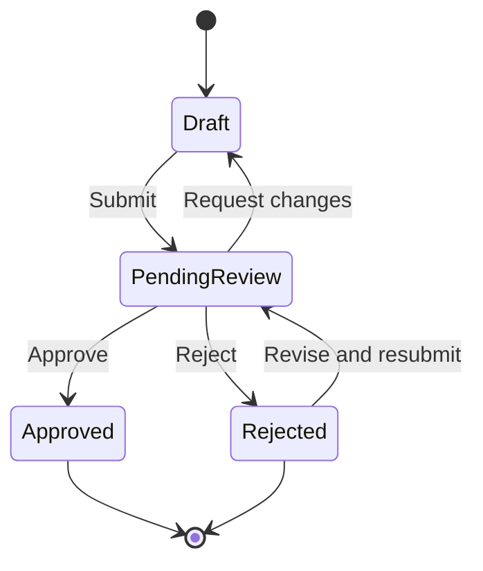

# Requirements Engineering Toolkit

A small, practical toolkit for people who write, review, and validate requirements —
especially when working alongside AI. It collects the checklists, prompts, patterns,
templates, and diagrams I reach for again and again.

Everything here is plain Markdown and Mermaid, so you can copy a file, drop it into
your own docs, or paste a prompt straight into an AI assistant.

> 🤖 **Using Claude Code?** Install the whole toolkit as a **plugin** in one step —
> five skills that *run* the workflows for you instead of you copy-pasting prompts:
>
> ```
> /plugin marketplace add clarityisrare/ai-requirements-toolkit
> /plugin install requirements-toolkit@ai-requirements-toolkit
> ```
>
> Prefer to grab a single skill by hand? See [`skills/`](./skills).

> Companion to [Clarity Is Rare](https://www.clarityisrare.com). Use freely, adapt to your
> context, and keep a human accountable for the final decision.

> ⭐ **If any of this saves you time, please star the repo.** Each star tells me the
> toolkit is useful and worth expanding. It costs you a click and means a lot.

---

## See it in action

**The core move: turn a vague requirement into a testable one.**

> ❌ *"The system should let users upload documents quickly and securely."*

Every word in that sentence hides a decision. Run it through the toolkit and you get:

> ✅ *"The system shall allow authenticated **customers** to upload **PDF** files up to
> **20 MB**. Each file shall be **virus-scanned before it becomes available** and be
> **visible only to the customer and reviewers in the owning department**."*

| Vague term | Made concrete as |
|---|---|
| users | authenticated customers |
| documents | PDF, up to 20 MB |
| quickly | a measurable notification SLA (within 1 minute) |
| securely | virus scan before availability + role-scoped visibility |

Every artifact here pushes in that direction — from **prompts** that draft the first version,
to **checklists** that catch what's missing, to **patterns** that carry the hard-won detail so
you don't rediscover it each time. See the full walkthrough in
[`examples/`](./examples).

Common workflows produce a diagram you can drop straight into a spec — this one is
[`diagrams/request-lifecycle-state.mmd`](./diagrams/request-lifecycle-state.mmd), rendered by
GitHub as-is:



---

## What's inside

| Folder | What it's for |
|---|---|
| [`skills/`](./skills) | 🤖 Installable **Claude Skills** — the whole toolkit as five guided workflows |
| [`examples/`](./examples) | Worked, before/after examples showing the toolkit in action |
| [`checklists/`](./checklists) | Quick pass/fail reviews for requirements, stories, NFRs, and AI output |
| [`prompts/`](./prompts) | Copy-paste prompts for AI-assisted requirements work |
| [`patterns/`](./patterns) | Reusable requirement patterns for common features |
| [`templates/`](./templates) | Fill-in-the-blank starting points for requirements artifacts |
| [`diagrams/`](./diagrams) | Mermaid source for common requirements diagrams |

### Claude Skills 🤖

The same toolkit, packaged as five installable [Claude Skills](./skills) that follow
the requirements lifecycle. Instead of copy-pasting a prompt, you describe your task in
plain language and Claude runs the workflow — asking the right questions, applying the
method, and self-checking against the bundled checklists.

- [`elicitation-planner`](./skills/elicitation-planner) — turn a thin business request into a workshop plan, stakeholder map, and glossary
- [`requirements-writer`](./skills/requirements-writer) — draft testable, traceable requirements, user stories, and NFRs (with the feature patterns built in)
- [`requirements-reviewer`](./skills/requirements-reviewer) — review requirements for ambiguity, risk, and readiness
- [`test-case-generator`](./skills/test-case-generator) — turn acceptance criteria into test cases plus a traceability matrix
- [`requirements-diagrams`](./skills/requirements-diagrams) — generate tailored Mermaid diagrams for a spec

**Install all five as a plugin (recommended).** In Claude Code, add this repo as a
plugin marketplace and install the bundle:

```
/plugin marketplace add clarityisrare/ai-requirements-toolkit
/plugin install requirements-toolkit@ai-requirements-toolkit
```

That's it — all five skills are now available and trigger automatically when you
describe a matching task. Update later with `/plugin marketplace update
ai-requirements-toolkit`.

**Or install a single skill by hand** — copy its folder into your Claude skills
directory; see [`skills/README.md`](./skills#installing).

### Examples

- [`vague-vs-clear-requirement.md`](./examples/vague-vs-clear-requirement.md) — the same requirement, rewritten from ambiguous to testable
- [`document-upload-worked-example.md`](./examples/document-upload-worked-example.md) — a one-line ask taken all the way to review-ready requirements
- [`ai-review-sample-output.md`](./examples/ai-review-sample-output.md) — what the AI review prompts actually return

### Checklists

- [`requirement-quality.md`](./checklists/requirement-quality.md) — completeness, clarity, testability, traceability
- [`user-story-quality.md`](./checklists/user-story-quality.md) — INVEST review plus AI quality checks
- [`nfr-checklist.md`](./checklists/nfr-checklist.md) — non-functional requirements, with measurable targets
- [`definition-of-ready.md`](./checklists/definition-of-ready.md) — is a backlog item ready to start?
- [`security-privacy-checklist.md`](./checklists/security-privacy-checklist.md) — security & privacy questions to ask early
- [`ai-output-validation.md`](./checklists/ai-output-validation.md) — validate anything an AI produced before you accept it

### Prompts

- [`acceptance-criteria-generator.md`](./prompts/acceptance-criteria-generator.md) — turn a requirement into Given/When/Then criteria
- [`acceptance-criteria-review-checklist.md`](./prompts/acceptance-criteria-review-checklist.md) — review the generated criteria
- [`user-story-generator.md`](./prompts/user-story-generator.md) — draft INVEST-compliant user stories
- [`nfr-generator.md`](./prompts/nfr-generator.md) — surface measurable non-functional requirements
- [`test-case-generator.md`](./prompts/test-case-generator.md) — turn acceptance criteria into test cases
- [`glossary-builder.md`](./prompts/glossary-builder.md) — extract a shared glossary from notes or transcripts
- [`ambiguity-detector.md`](./prompts/ambiguity-detector.md) — surface vague, subjective wording
- [`requirement-review.md`](./prompts/requirement-review.md) — risk-classified review of a single requirement
- [`elicitation-workshop.md`](./prompts/elicitation-workshop.md) — plan a stakeholder elicitation workshop

### Patterns

- [`document-upload.md`](./patterns/document-upload.md) — file uploads, validation, scanning, metadata
- [`notifications.md`](./patterns/notifications.md) — events, channels, content, delivery, failures
- [`approvals.md`](./patterns/approvals.md) — review and authorization workflows
- [`access-control.md`](./patterns/access-control.md) — roles, permissions, and data scope (RBAC)
- [`search-and-filtering.md`](./patterns/search-and-filtering.md) — search, filters, sorting, pagination
- [`data-export.md`](./patterns/data-export.md) — CSV/Excel/PDF exports, scope, and privacy
- [`integration-api.md`](./patterns/integration-api.md) — inbound/outbound APIs, retries, idempotency
- [`audit-trail.md`](./patterns/audit-trail.md) — recording who did what and when
- [`AI-Prompt-Is-The-New-Requirement.md`](./patterns/AI-Prompt-Is-The-New-Requirement.md) — treating prompts as requirements

### Templates

- [`requirements-contract.md`](./templates/requirements-contract.md) — one-page problem/value/scope contract
- [`ai-ready-requirement.md`](./templates/ai-ready-requirement.md) — a complete, traceable requirement
- [`nfr-specification.md`](./templates/nfr-specification.md) — a single non-functional requirement
- [`stakeholder-analysis.md`](./templates/stakeholder-analysis.md) — interest, influence, and engagement
- [`glossary.md`](./templates/glossary.md) — shared definitions for the domain
- [`decision-record.md`](./templates/decision-record.md) — record a decision and its trade-offs (ADR)
- [`risk-register.md`](./templates/risk-register.md) — track risks, severity, and owners
- [`traceability-matrix.md`](./templates/traceability-matrix.md) — link requirements to stories and tests

### Diagrams

Mermaid (`.mmd`) source you can render on [mermaid.live](https://mermaid.live), in GitHub
Markdown, or in any Mermaid-aware tool.

- [`context-diagram.mmd`](./diagrams/context-diagram.mmd) — the system and everything around it
- [`use-case-overview.mmd`](./diagrams/use-case-overview.mmd) — actors and their use cases
- [`approval-process.mmd`](./diagrams/approval-process.mmd) — approval flow
- [`request-lifecycle-state.mmd`](./diagrams/request-lifecycle-state.mmd) — request states and transitions
- [`upload-sequence.mmd`](./diagrams/upload-sequence.mmd) — document upload sequence
- [`requirements-traceability.mmd`](./diagrams/requirements-traceability.mmd) — requirement to test linkage

---

## How to use it

1. **Browse by task.** Writing criteria? Start in `prompts/`. Reviewing someone else's
   work? Start in `checklists/`.
2. **Copy, don't depend.** Take what's useful into your own repo or wiki and adapt the
   wording to your domain and glossary.
3. **Keep a human in the loop.** The AI prompts and checklists assume a Requirements
   Engineer, Product Owner, or SME makes the final call.

## Star this repo ⭐

If the toolkit is useful to you, a star genuinely helps. It's a signal that this is worth
maintaining and growing — and it shapes how much time I put into new patterns, prompts,
templates, and skills. Thank you.

## Contributing

Issues and pull requests are welcome — new patterns, better prompts, and clearer
wording especially. Keep files as plain Markdown or Mermaid so they stay easy to reuse.

## License

Released under the [MIT License](./LICENSE).
