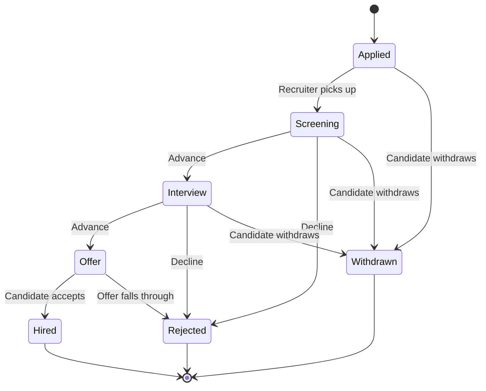

# Worked example: a spec description → a tailored diagram

This shows the one move the skill turns on — taking a real description and
rebuilding a reference around it, rather than relabeling the sample. It starts
from [`diagrams/request-lifecycle-state.mmd`](diagrams/request-lifecycle-state.mmd)
and derives a different lifecycle from a different domain.

## The user's description

> We're speccing an applicant tracking system. A candidate applies, which puts the
> application in *Applied*. A recruiter screens it and either advances it to an
> *Interview* or declines it. After the interview it's either advanced to an
> *Offer* or declined. From *Offer* the candidate either accepts — they're *Hired* —
> or the offer falls through. A candidate can withdraw any time before an offer is
> accepted. Declined and withdrawn applications are closed.

## The diagram derived from it

## What changed from the sample, and why

- **Every state name is the domain's own.** *Draft / PendingReview / Approved* became
  *Applied / Screening / Interview / Offer / Hired* — the sample's names describe an
  approval, not a hiring pipeline.
- **The shape changed, not just the labels.** The sample has one review step; this
  pipeline has three sequential gates (screen, interview, offer), so *Rejected* is
  reachable from three states rather than one.
- **A transition was added where the domain has one the sample lacks.** *Withdrawn*
  is reachable from every pre-offer state, because the description says a candidate
  can withdraw any time before accepting — the sample only allowed a withdraw from
  *Draft*.
- **The terminal set follows the description.** *Hired*, *Rejected*, and *Withdrawn*
  are the three closed outcomes the user named; nothing else terminates.

A relabel of the sample would have kept its single review step and its one withdraw
edge, and it would have described the sample's system instead of this one.
